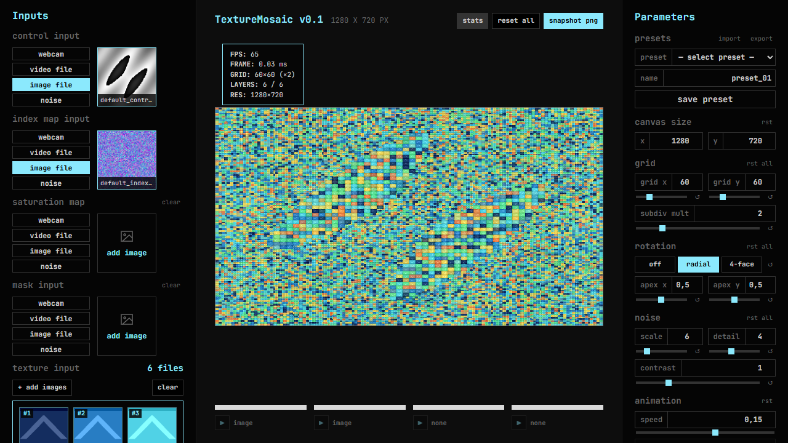
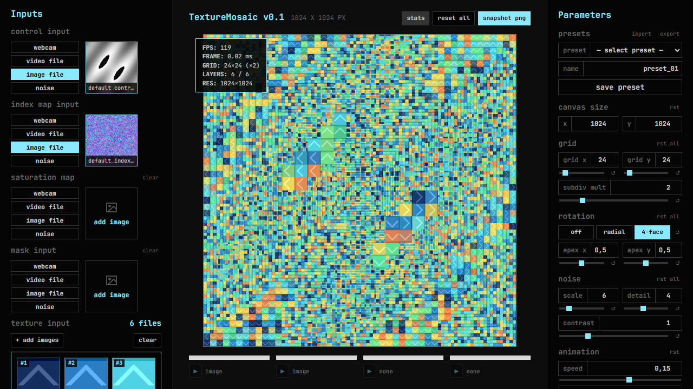
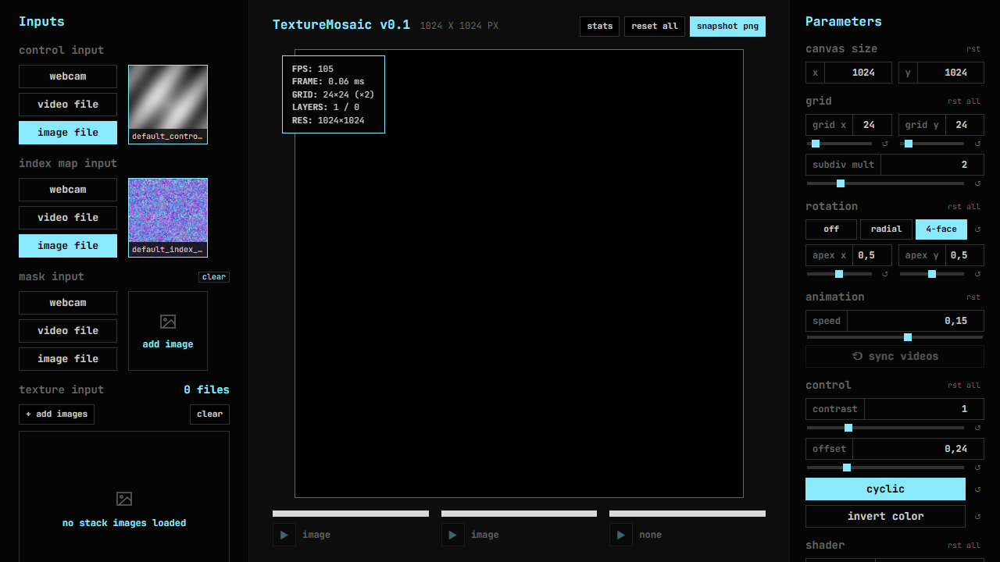
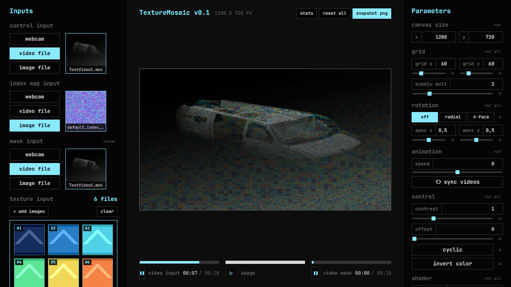
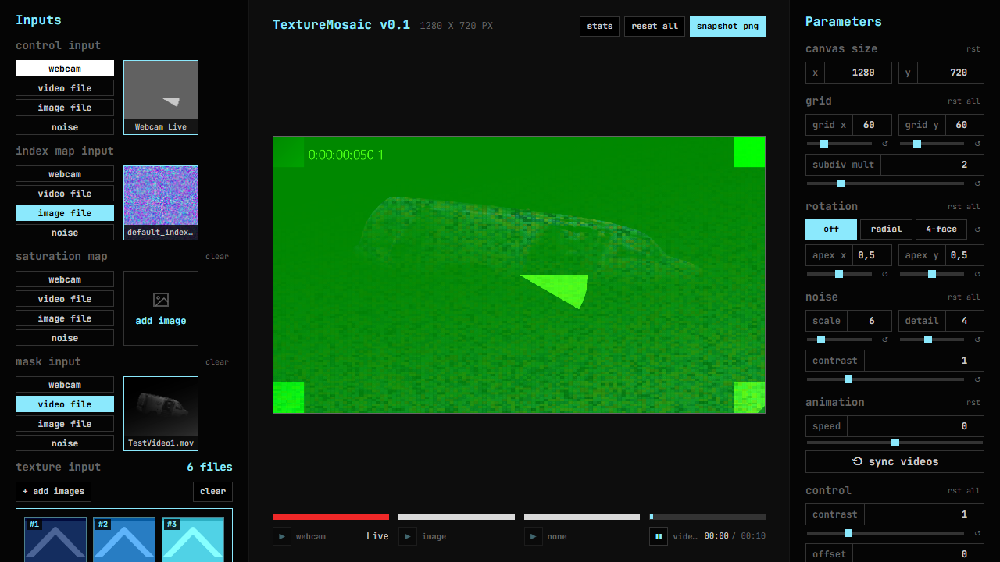

# Texture Mosaic v0.1 — Automated Test & Verification Report

Date: 2026-10-25  
Spec Version: `Specification/texture-mosaic-spec-v0.1.md`

---

## 1. Automated Test Summary

All automated unit and end-to-end WebGL2 pixel tests passed with zero errors:

| Suite | Runner | Tests | Status | Duration |
|---|---|---|---|---|
| `tests/unit/shader-and-clock.test.ts` | Vitest (`v3.2.7`) | 13 passed | PASS | ~37 ms |
| `tests/e2e/texture-stack.spec.ts` | Playwright (`Desktop Chrome` WebGL2) | 6 passed (115+ assertions) | PASS | ~32.8 s |

### Verified Items (§8.2)

- **Shader pixel verification vs. plain-code CPU reference (§4)** (tolerance ±3 / 255):
  - **Grid:** Base cell boundaries land exactly on `gridSize` divisions (`4×4` verified across columns `0..3`); pixels inside a base cell share its subdivision level `L`.
  - **Subdivision:** Control luminance bands map to `L = 0, 1, 2, 3` with `cyclic = 0`; `cyclic = 1` wraps `L = 3 → L = 0`; `subdiv multiplier` verified at `1.5`, `2`, and `4`.
  - **Rotation:** Mode `0` (`off`) is identity; Mode `1` (`radial`) continuously rotates each cell's `+Y` toward `apexUV`; Mode `2` (`4-face`) snaps each cell's `+Y` to North/South/East/West (`±X` or `±Y`) around the apex (verified on cells above, below, left, and right of the apex).
  - **Index maps:** Normalized decode (`from`/`to` rounding and clamping), `t` crossfade (`B` channel), `smooth blend` on (`mix(from, to, t)`) vs. off (`from` only), `n = 1`, `n = 2`, `n = 32`, and `num images` lower than loaded (`5` of `32`).
  - **Control:** `contrast = 1` (unchanged), `contrast = 0` (flat mid-grey `0.5`), `contrast = 2.5` (boosted); `offset` with clamp (`cyclic = 0`) and wrap (`cyclic = 1`); BT.709 luminance weights (`0.2126`, `0.7152`, `0.0722`) verified with pure red, pure green, and pure blue control textures; `invert color` toggle.
  - **Mask:** White (`1.0`), black (`0.0`), and mid-grey (`0.5`) masks; `maskMin` / `maskMax` range remap including `maskMin > maskMax` (`0.8 > 0.2`); `invertMask`; `maskInfluence` at `0`, `0.5`, and `1`; mask luminance weights (`0.2126`, `0.7152`, `0.0722`) verified with pure R/G/B masks; verified that the original control image shown where mask is black (`m = 0`) has **no contrast and no offset** even when `contrast = 3.5` and `offset = 0.8`.
  - **Orientation & GL errors:** Verified across all 4 quadrants (`Top-Left`, `Top-Right`, `Bottom-Left`, `Bottom-Right`), with `gl.getError()` returning `[]` after every case.
  - **Adaptive Saturation Control FX pass (`fx_saturation.frag`, D5 & U8):** Ported `Shaders/saturation_control_pixel.glsl` to WebGL2 as Pass 2 (removing `fx_passthrough.frag`). Verified GPU vs. CPU pixel parity for empty saturation map (`51/255 = 0.2` fallback with default `min = 0, max = 5` → `satAmount = 1.0` untouched), `R = 0` (`satMin = 0` grayscale Rec. 709 luma), `R = 128` mid-boosted, and `R = 255` (`satMax` oversaturated).
  - **Transparency (D13):** Semi-transparent stack image (`alpha = 128`) flattened over black on load and output with opaque `alpha = 255`.
- **4 Media Inputs (`control`, `indexMap`, `satMap`, `mask` — D1, D5, D14, D15, U6, U8):**
  - Left `Inputs` column provides 4 independent `webcam` / `video file` / `image file` input slots: **control input** (`uControl`), **index map input** (mapped to all 4 shader `uIndexMap0..3`), **saturation map** (`uSatMap` in Pass 2 FX), and **mask input** (`uMask`).
  - Verified that loading a texture, video, or webcam into `index map input` binds to all 4 subdivision levels (`L = 0..3`), and `saturation map` drives Pass 2 saturation with a `clear` button restoring neutral `1.0` saturation.
  - Removed the procedural `index maps` parameter group (`seed`, `transition duration`, `shuffle`) from the right Parameters panel, and added the **saturation** parameter group (`min` and `max`, range `0..5`, defaults `0` and `5`).
  - Bottom playback bar displays 4 independent transports (Control, Index Map, Saturation Map, Mask), and `⟲ sync videos` restarts all loaded videos across all 4 slots from time `0`.
- **Selectable Perlin Noise Source (`src/engine/noise.ts`, U9):**
  - Added a 4th `noise` source button to each of the 4 input slots (`control`, `indexMap`, `satMap`, `mask`) backed by a shared deterministic multi-octave Perlin noise generator.
  - Added the `noise` parameter group (`scale` `0.5..32` default `6`, `detail` `1..8` default `4`, `contrast` `0..4` default `1`) in the Parameters column; verified that each control updates all active `noise` slots and their thumbnails in real time and resets restore the default state.
- **Live Processed Input Preview Thumbnails (`src/engine/previews.ts`, U10):**
  - Input preview thumbnails in the Left `Inputs` column display the real-time processed signal before entering the shader: Control shows the grayscale level-driving signal (`invertControl` → `contrast` → Rec.709 `luma` → `offset` clamp/wrap); Saturation Map shows the normalized `mix(satMin, satMax, r)` multiplier; Mask shows the remapped `m` factor (`maskMin` / `maskMax` / `invertMask` / `maskInfluence`); and `noise` slots reflect `scale`, `detail`, and `contrast` changes live.
- **Manual Canvas Size input fix (U7):**
  - Fixed `updateUI()` so `resolution-width-input` and `resolution-height-input` are never overwritten during live animation frames while the user is typing, and commit on `Enter` or `change`/blur. Verified with a regression test typing a new resolution while `animSpeed = 0.25` is actively running.
- **App & UI behavior:**
  - Every control across all 6 groups (`Grid`, `Rotation`, `Index maps`, `Control`, `Shader`, `Mask`) updates the rendered output in real time and its individual/group reset button restores the default output (D8).
  - Control and mask source switching (`video file`, `image file`, `webcam`) without reloading the page (D1).
  - Stack add, remove, and reorder (`stack-move-down-0` / drag-reorder) updating GPU layer order immediately (D2).
  - 32 layers at `1280×720` (`TEXTURE_2D_ARRAY`, ~118 MB) allocated with zero GL errors (§5).
  - Mask controls disabled when no mask is loaded (`uMaskInfluence = 0`), automatically enabled with `maskInfluence = 1` on mask load, and disabled again on clear (D11).
  - Working resolution change (`1280×720` → `640×360` → `1024×1024`) resizing the output canvas and re-fitting stack layers (D4).
  - PNG snapshot (`captureSnapshotDataUrl()`) produces a valid PNG matching the working resolution with opaque `alpha = 255` (D7, D13).
  - Visible UI error toast (`[data-testid="error-toast"]`) when exceeding 32 images or loading unsupported files, and zero console errors on load (D9).
- **Offset animation with controlled clock (§3 & §8.2):**
  - `speed = 0` keeps `offset` frozen.
  - Positive speed (`0.2`) advances `offset` linearly (`start + speed × dt` wrapped to `0..1`) and moves the `offset` slider in the UI.
  - Negative speed (`-0.25`) runs backwards and wraps `0 → 1`.
  - Dragging the `offset` slider sets the current position and animation continues from there.
  - Hidden tab (`visibilitychange` / `setTabHiddenSimulated(true)`) pauses animation with zero jump on return.
  - Reset-to-default on `offset` resets both `offset` and `speed` to `0`.
  - With `cyclic` on, pixel output across the `0.999 → 0.001` wrap boundary has no jump.
- **Dual playback transports & video sync (D14):**
  - Control (left) and Mask (right) transports render independently: video shows play/pause, progress bar, and `MM:SS / MM:MM`; webcam shows red track + `Live`; image/empty shows static grey track.
  - `⟲ sync videos` button restarts all loaded videos from time `0`; newly loaded videos start at `0`.
  - All input thumbnails (image, video, webcam) are square cover-cropped to preserve aspect proportions.
- **Static HTTP serving (§8.2):**
  - Production `dist/` verified both at root (`/`) and mounted under a subfolder (`/subfolder/`) with zero missing files or console errors.

---

## 2. Performance Numbers (§8.2)

Measured in Desktop Chrome with WebGL2 at `1280×720` working resolution, `60×60` base grid (`subdiv multiplier = 2`), radial rotation (`mode = 1`), and 16 loaded stack layers:

- **Average GPU render pass time (Mosaic pass → FX FBO pass → Canvas):** `0.29 ms / frame` (`~3390 fps` headroom)
- **Observed live frame rate in review build (`/?demo=1`):** `60 – 110 fps` (well above the 30 fps target in §5)
- **32-layer allocation at `1280×720`:** Succeeded with `0` WebGL errors

---

## 3. Screenshots

### Demo Scene — 16:9 (`1280×720`, Grid `60×60`, Radial Rotation) with Stats Overlay (`/?demo=1`)

### Demo Scene — 1:1 (`1024×1024`, Grid `24×24`, 4-Face Snap Rotation)

### Empty Stack & Mask State

### Dual Playback Transports — Control video + Mask video (D14)

### Playback Transports — Webcam "Live" + Mask video (D14)

---

## 4. Known Limitations & Not Verified (§8.4)

- **Physical webcam hardware stream:** The `webcam` transport and `getUserMedia` flow are verified end-to-end using Chrome's fake media device (`--use-fake-device-for-media-stream`); a physical camera was not tested in automation.
- **Sustained dual-video hardware decoding on battery/mid-range laptop GPU:** Single-tab Chrome WebGL2 rendering takes `~0.29 ms/frame`, but real-world thermal/battery behavior with two simultaneous high-bitrate videos should be judged on your machine during review.

---

## 5. Netlify Deployment (2026-10-25)

- **Site:** https://texturemosaic.netlify.app (project `texturemosaic`, site ID `c304b92a-8570-4258-82d1-7a6d7c436337`, team `src.phag`), deployed via `netlify deploy --build --prod`.
- **Config (`netlify.toml`):** `npm run build` → `publish = "dist"`, Node 22 build environment, security headers (`X-Frame-Options`, `X-Content-Type-Options`, `Referrer-Policy`), `Permissions-Policy: camera=(self)` for webcam input, immutable caching for hashed `/assets/*`, production sourcemaps disabled.
- **Debug API gating (§8.2):** `window.__TEXTURE_MOSAIC_DEBUG__` is exposed in dev/test builds, and in production only with `?debug=1`. Verified on the live site: not exposed by default.
- **Live verification:** `?demo=1` loads the 25-layer demo dataset at 1280×720 with zero console errors and zero error toasts; render canvas is 1280×720.
